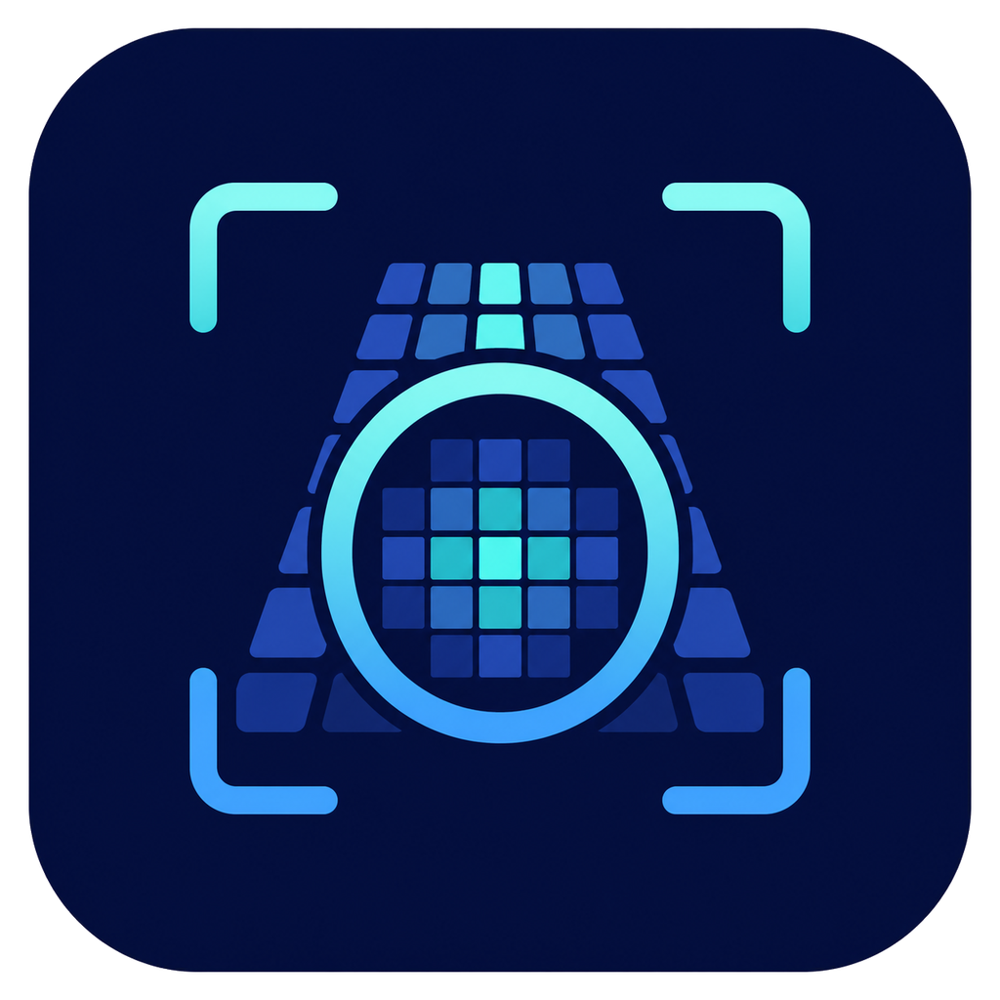
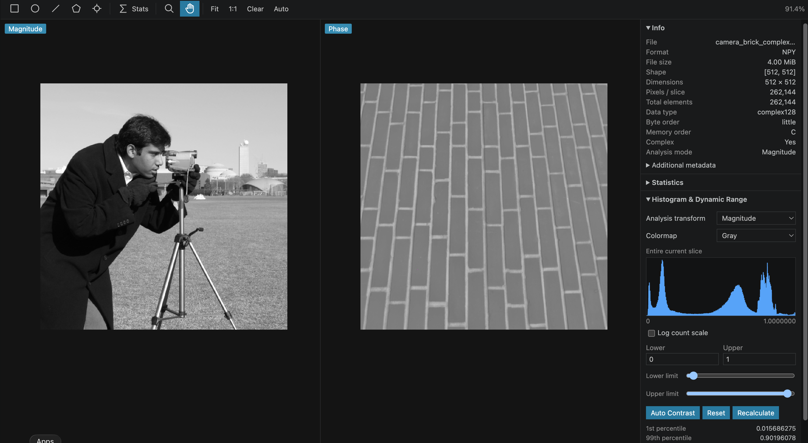

# ArrayScope Scientific Image Viewer



ArrayScope is a interactive VSCode exension for viewing and analyzing scientific NPY and TIFF images. It runs out-of-the-box - no environment setup is needed.



## Features

- NPY 1.0, 2.0, and 3.0 files with boolean, signed/unsigned integer, `float32`, `float64`, `complex64`, and `complex128` values.
- C-order, Fortran-order, and big-endian NPY data.
- Grayscale integer and floating-point TIFF images.
- 2D images and 3D/multipage stacks with slice navigation.
- Progressive loading and GPU-accelerated rendering.
- Interactive display-range and colormap changes.
- Synchronized magnitude and phase panels for complex arrays, with magnitude, phase, real, imaginary, log-magnitude, and magnitude-squared analysis modes.
- Rectangle, ellipse, line, polygon, sampler, magnifier, and pan tools.
- Selection-aware histograms, 1st/99th percentile auto contrast, and statistics for local and remote files.
- Full-resolution pixel value sampling.
- Manual image registration with draggable, progressively tiled overlays and transparency controls.
- VS Code theme colors, accessible controls, commands, and configurable keyboard shortcuts.

## Use

Open a `.npy`, `.tif`, or `.tiff` file. If VS Code does not select ArrayScope automatically, run **Reopen Editor With… → ArrayScope Scientific Image Viewer**.

The viewer never writes to the source. A selection scopes histogram, auto contrast, and the next explicit statistics calculation. Without a selection, all three operations use the entire current slice. The initial dynamic range uses the finite minimum and maximum; **Auto Contrast** applies the active scope's 1st and 99th percentiles, and **Reset** restores its finite minimum and maximum. Changing slices preserves selection geometry and clears the current sample marker.

Complex images always show synchronized Magnitude and Phase panels. The **Analysis transform** selector controls which representation is used by the histogram, auto contrast, and statistics.

## Keyboard shortcuts

These shortcuts are active while an ArrayScope editor is active. They are disabled when a text input or terminal has focus, so they do not interfere with typing elsewhere in VS Code.

| Shortcut | Action |
| --- | --- |
| `R` | Rectangle selection |
| `E` | Ellipse selection |
| `L` | Line selection |
| `P` | Polygon selection |
| `I` | Sample a pixel |
| `Z` | Magnifier tool |
| `H` | Pan tool |
| `Space` + drag | Pan temporarily without changing tools |
| `-` | Zoom out |
| `=` | Zoom in |
| `F` | Fit image to window |
| `1` | Show actual pixels (1:1) |
| `[` | Previous slice |
| `]` | Next slice |
| `Ctrl+T` (`Cmd+T` on macOS) | Calculate statistics |
| `Ctrl+K` (`Cmd+K` on macOS) | Plot the current line selection's pixel profile |
| `Ctrl+Alt+Backspace` (`Cmd+Alt+Backspace` on macOS) | Clear selection |

## Remote workspaces

ArrayScope supports Remote SSH, WSL, and dev containers:

- files are opened and decoded near remote storage;
- only the data needed for the current view are sent to the viewer;
- the complete source array is not transferred by default.

Files larger than 256 MiB on non-file VS Code file systems require a provider that supports range reads.

## Settings

```json
{
  "scientificImageViewer.localCacheMB": 256,
  "scientificImageViewer.remoteCacheMB": 512,
  "scientificImageViewer.tileSize": 256,
  "scientificImageViewer.automaticHistogramPixelLimit": 1000000
}
```

The local cache limit applies to each open viewer. The remote cache limit applies to each open file.
Histograms are calculated automatically only when the active scope—the current slice or selection—contains at most `automaticHistogramPixelLimit` pixels. For larger scopes, click **Recalculate** in the histogram panel. Set the limit to `0` to require an explicit calculation for every non-empty scope.

## Supported data and limitations

NPY supports scalar images shaped `[y, x]` and stacks shaped `[slice, y, x]`. When an array has at least three dimensions and its last dimension has size 3 or 4, ArrayScope asks whether to interpret that dimension as RGB/RGBA channels. Accepting displays `[y, x, channels]` as a color image; additional leading dimensions are flattened in logical C order into navigable slices, including for Fortran-order files. Choosing **Keep dimensions** (or dismissing the prompt) preserves the scalar interpretation. Scalars show their value; empty arrays, 1D arrays, and scalar arrays above 3D show an explicit dimensionality message. Color interpretation requires real-valued samples. Object and variable-length dtypes are rejected.

TIFF supports grayscale and RGB/RGBA pages (RGB photometric interpretation, with three or four samples per pixel). RGB/RGBA TIFFs also ask whether to interpret the last dimension as channels. Keeping dimensions treats a single `[y, x, channels]` page as a scalar stack; multipage color TIFFs require channel interpretation to display. Pages must match the first page's dimensions, sample type, and channel count to participate in a stack. All color channels must share a sample type. Available compression formats depend on the bundled TIFF decoder.

Color tiles preserve the original channel values. The sampler shows RGB/RGBA values and luminance; histograms, statistics, and line profiles use luminance `0.2126 R + 0.7152 G + 0.0722 B` in source units, excluding alpha. Color display bypasses colormaps and applies the dynamic range equally to RGB; integer samples initially use their positive dtype range, and floats use 0–1. RGBA alpha uses that dtype range independently of contrast. Associated (premultiplied) TIFF alpha is unpremultiplied for display; analysis and sampling retain the stored values. Reopen the file to choose its interpretation again.

## Development

Requirements: Node.js 20 or newer and npm. From a fresh checkout, install the
locked dependencies and run the same fast checks used by CI:

```bash
npm ci
npm run typecheck
npm test
npm run build
```

Use `npm run test:watch` while developing to rerun unit tests after changes. Run
an individual test file or a test matching a specific name with:

```bash
npm test -- test/geometry.test.ts
npm test -- -t "selection rasterization"
```

To exercise the extension in a real VS Code Extension Development Host, run:

```bash
npm run test:integration
```

The integration command downloads a matching VS Code test build on first use.
On a headless Linux machine, run it through Xvfb:

```bash
xvfb-run --auto-servernum npm run test:integration
```

Press `F5` from VS Code after building to inspect the extension manually. To
run the full release validation and produce a VSIX, run:

```bash
npm run package
```

`package` cleans generated output, type-checks, runs unit tests, bundles the
extension, and packages it.

## Numerical definitions

Statistics use population variance and standard deviation. Ordinary kurtosis is reported (a normal distribution has kurtosis 3). NaN, positive infinity, and negative infinity are excluded from finite statistics and reported separately. Median and histogram results are marked approximate when sampling is used.

## Security and failure behavior

ArrayScope validates NPY files before reading their data and detects source-file changes while an editor is open. Decoder and parsing errors appear in the custom editor with expandable technical details.
